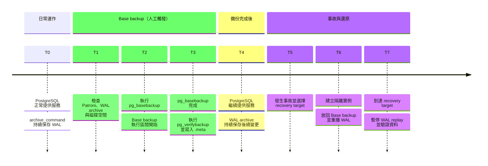
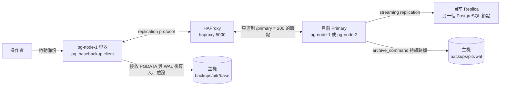
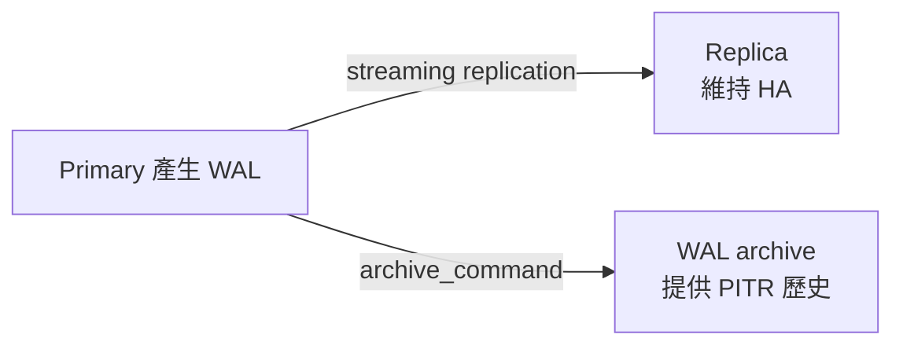
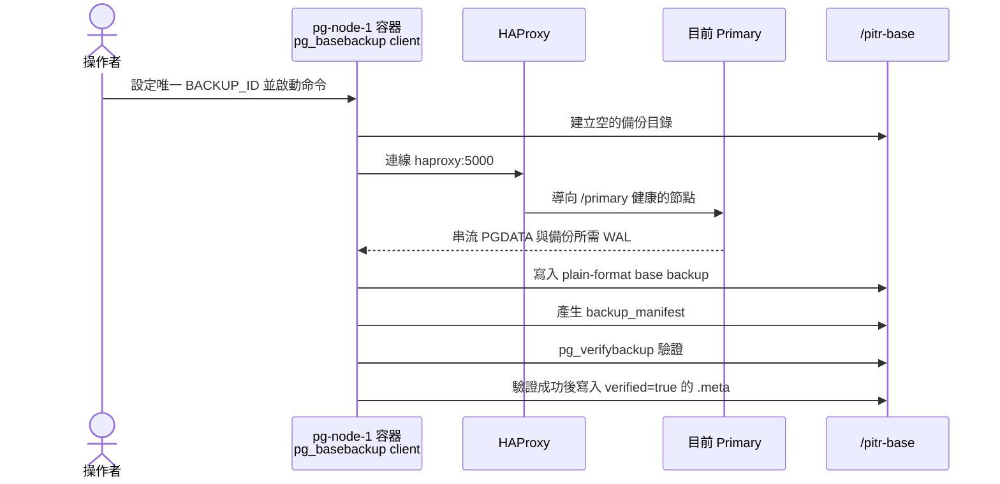
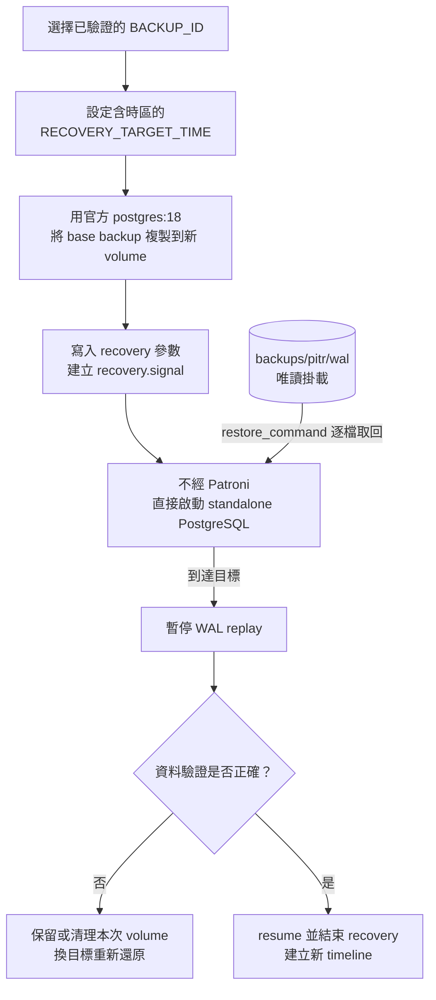
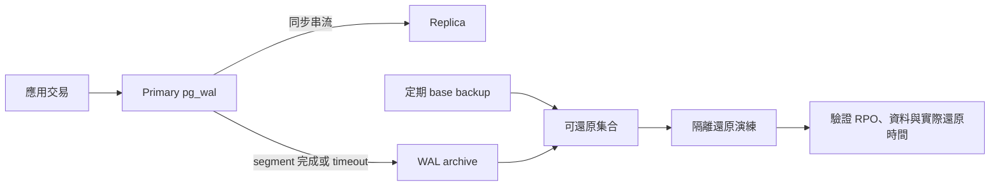

# 本專案的 PostgreSQL PITR 備份流程

本文件說明目前專案如何使用 PostgreSQL 18、Patroni、HAProxy 與 Docker 建立及驗證 PITR（Point-in-Time Recovery）備份。重點是理解專案內的資料流、設定參數與工具分工。

可直接執行的完整指令與檢查清單，請參閱 [PostgreSQL PITR 備份與還原操作手冊](../operations/BACKUP_DOC.md)。

## 一、目前採用的備份設計

本專案的 PITR 由兩種資料共同組成：

1. **Base backup**：某一段時間內 PostgreSQL 整個資料目錄的一致性副本。
2. **WAL archive**：從 base backup 開始到目標時間之間，持續產生的資料變更紀錄。

還原時先放回 base backup，再依序重播 WAL，讓資料庫前進到指定時間。只有 base backup，最多只能還原到該份備份完成時的狀態；只有 WAL，則沒有可供重播的起點。本專案使用 `--wal-method=stream` 把 base backup 自身達到一致狀態所需的 WAL 放入備份，同時要求 continuous archive 在備份前就已正常運作，以保存後續 PITR 所需的連續歷史。



目前沒有自動備份排程。`T2` 是操作者完成檢查後手動執行 base backup 的時間點；WAL archive 則從 `T0` 到 `T5` 持續運作，不只在 base backup 期間執行。

目前流程有以下邊界：

- Base backup 由人員手動執行，尚未排程。
- 備份位於主機的 `backups/pitr`，與資料庫仍在同一台主機，不是異地備份。
- 還原流程會以官方 `postgres:18` image 建立獨立的 standalone PostgreSQL，不會直接覆寫 Patroni 正在使用的 data volume。
- 還原實例不使用 Docker Compose、Patroni、etcd、HAProxy 或 HA Compose network；它與 HA 環境唯一的關係是讀取事先產生的 base backup 與 WAL archive。
- 還原實例只用於驗證，不應直接接收正式流量。

## 二、專案元件與資料流

### 1. 備份架構



這個設計刻意把「在哪個容器執行命令」與「從哪個 PostgreSQL 節點讀資料」分開：

- `pg_basebackup` 固定在 `pg-node-1` 容器內執行，因為該映像已包含 PostgreSQL 工具，且 `/pitr-base` 已掛載。
- 備份來源不是固定的 `pg-node-1`，而是 `haproxy:5000` 所指向的當前 Primary。
- HAProxy 以 Patroni 的 `/primary` API 判斷角色，因此 switchover 後仍能把新的備份連線送往正確節點。
- 兩個 PostgreSQL 容器共同掛載相同的 WAL 與 base 目錄，角色切換後的新 Primary 仍能繼續寫入同一個 archive。

HAProxy 只負責**建立連線時**選擇 Primary。若 base backup 進行中發生 failover，既有 TCP 連線不會被搬到新 Primary，該次備份通常會失敗，必須使用新的 `BACKUP_ID` 重做。

### 2. 專案檔案對照

| 檔案或目錄 | 在備份流程中的用途 |
| --- | --- |
| `.env` | 設定 `PITR_BACKUP_ROOT` 及 PostgreSQL、replication、Patroni 帳號環境變數 |
| `docker-compose.yaml` | 將主機備份目錄 bind mount 到兩個 PostgreSQL 容器，並定義服務與連接埠 |
| `patroni/patroni.yml` | 定義 WAL archive 參數；新叢集 bootstrap 時寫入 DCS |
| `haproxy/haproxy.cfg` | 透過 Patroni `/primary` 將連線導向目前 Primary |
| `backups/pitr/base` | 保存每份 base backup 目錄及對應的 `.meta` |
| `backups/pitr/wal` | 保存連續歸檔的 WAL segment、backup history 與 timeline history |
| `docs/operations/BACKUP_DOC.md` | 備份、監控及隔離還原的可執行操作手冊 |
| `tests/pitr_backup_test.sql` | 建立可供備份與還原演練確認的測試資料 |

## 三、工具如何分工

| 工具 | 本專案中的責任 | 不負責的事情 |
| --- | --- | --- |
| PostgreSQL archiver | Primary 運行期間持續執行 `archive_command` | 不建立 base backup |
| `pg_basebackup` | 透過 replication protocol 建立完整實體備份 | 不會持續保存備份完成後產生的 WAL |
| `pg_verifybackup` | 依 `backup_manifest` 檢查檔案與備份所需 WAL | 不等於實際啟動及查詢還原資料庫 |
| Patroni | 管理 Primary/Replica 角色與動態 PostgreSQL 設定 | 不保存 base backup 或 WAL archive |
| `patronictl` | 查詢叢集角色、修改 DCS 動態設定及安排重啟或 switchover | 不直接執行 PostgreSQL 實體備份 |
| etcd | 保存 Patroni leader lock 與叢集設定 | 不包含 PostgreSQL 使用者資料 |
| HAProxy | 將新連線送到目前 Primary | 不接續 failover 前已存在的備份連線 |
| DBeaver | 對正式 Primary 或 `127.0.0.1:55432` 還原實例執行狀態及資料驗證 SQL | 不執行 Docker、檔案複製或 volume 操作 |
| Docker bind mount | 讓兩個節點與主機共用備份檔案 | 不提供異地、immutable 或 object storage 保護 |
| 官方 `postgres:18` image | 不經 Patroni 直接啟動 standalone PostgreSQL 進行 recovery | 不會加入或重建 HA 叢集 |
| Docker named volume | 每次演練建立全新 PGDATA，與 HA 節點 volume 分離 | 不會自動驗證還原後的應用資料 |

## 四、持續 WAL 歸檔參數

以下參數位於 `patroni/patroni.yml` 的 `bootstrap.dcs.postgresql.parameters`：

```yaml
archive_mode: "on"
archive_command: "test ! -f /wal-archive/%f && cp %p /wal-archive/%f"
archive_timeout: 60s
```

### `archive_mode: "on"`

啟動 PostgreSQL archiver。Primary 完成一個 WAL segment 後，會呼叫 `archive_command` 將它保存到 archive。

這個參數需要重新啟動 PostgreSQL 才會生效。Patroni 的 `bootstrap.dcs` 只會套用於第一次建立叢集；既有叢集必須使用 `patronictl edit-config` 更新 DCS，再依序重啟節點。操作方式請見操作手冊的「首次啟用 PITR」。

### `archive_command`

```text
test ! -f /wal-archive/%f && cp %p /wal-archive/%f
```

PostgreSQL 執行命令時會替換兩個佔位符：

| 佔位符 | 意義 |
| --- | --- |
| `%p` | PostgreSQL `pg_wal` 內待歸檔檔案的完整來源路徑 |
| `%f` | 不含路徑的 WAL 檔名 |

命令先確認目的檔不存在，再複製到 `/wal-archive`。這可避免同名 WAL 被靜默覆寫。如果命令回傳非零，PostgreSQL 會把該次歸檔視為失敗並持續重試，因此需要監控 `pg_stat_archiver.failed_count` 與 `last_failed_wal`。

容器路徑與主機路徑的對應來自 `docker-compose.yaml`：

```yaml
- ${PITR_BACKUP_ROOT}/wal:/wal-archive
- ${PITR_BACKUP_ROOT}/base:/pitr-base
```

`.env` 目前將 `PITR_BACKUP_ROOT` 指向 `./backups/pitr`，所以 `/wal-archive` 最終會寫到專案的 `backups/pitr/wal`。

### `archive_timeout: 60s`

如果寫入量很低，WAL segment 可能很久才填滿。`archive_timeout` 會促使 PostgreSQL 定期切換 WAL，讓尚未歸檔的變更不會長時間只留在 `pg_wal`。

它不是「每 60 秒一定產生一份完整備份」，也不保證事故時完全沒有資料遺失；最近一段尚未成功歸檔的 WAL 仍可能只存在資料節點。較短的值通常會增加未填滿 WAL segment 的數量與儲存用量。

### 其他相關 PostgreSQL 參數

同一段 Patroni 設定中還有幾個會影響 HA 或 base backup 的參數：

| 參數 | 目前值 | 與備份流程的關係 |
| --- | --- | --- |
| `wal_level` | `replica` | 寫入足以支援 physical replication 與 WAL archiving 的資訊；PITR 至少需要此等級 |
| `max_wal_senders` | `10` | WAL sender 的數量上限；目前的 streaming replication 與 `pg_basebackup --wal-method=stream` 都會使用 |
| `max_replication_slots` | `10` | 可建立的 replication slot 數量上限，供 Patroni 管理 Replica；目前 base backup 命令本身沒有指定 slot |
| `wal_keep_size` | `128MB` | 在 `pg_wal` 額外保留一段 WAL，協助短暫落後的 Replica；不是 archive retention，也不能取代 `/wal-archive` |
| `wal_log_hints` | `on` | 讓 `pg_rewind` 能在節點角色切換後修復舊 Primary；不是 PITR 的必要條件 |
| `hot_standby` | `on` | 允許 recovery 中的 Replica 接受唯讀查詢；不決定 archive 保存多久 |

`pg_basebackup --wal-method=stream` 需要一條傳輸備份的 replication connection，並再使用一個 WAL sender 串流 WAL。因此調低 `max_wal_senders` 前，必須同時計算 Replica 與備份的連線需求。

### 與 streaming replication 的差別

同一份 WAL 在專案中有兩條不同用途的路徑：



Replica 會忠實重播誤刪等錯誤操作，所以 replication 不能取代 PITR archive。反過來，archive 也不會像 Replica 一樣自動承接線上流量。

## 五、建立 base backup 的流程與參數

### 1. 備份前檢查的理由

操作手冊要求先確認以下條件：

| 檢查 | 理由 |
| --- | --- |
| Patroni 只有一個 Leader | 避免在角色不明或叢集異常時開始備份 |
| Replica 為 `streaming` | 確認 HA 基本狀態正常；這不是 base backup 一致性的必要條件，但可降低同時處理 HA 故障的風險 |
| `pg_stat_archiver` 正常 | Base backup 成功不代表後續 WAL 已保存；archive 異常時會形成無法跨越的 gap |
| 沒有自訂 tablespace | Plain format 會依 tablespace 的絕對路徑處理資料；目前複製與還原流程只設計了單一 PGDATA volume |
| `/pitr-base` 與 `/wal-archive` 空間充足 | 空間耗盡可能同時中斷備份，並使 Primary 的 `pg_wal` 持續累積 |

如果查到自訂 tablespace，不能直接沿用目前指令。需要先定義 `--tablespace-mapping`、額外 mount、還原路徑與權限，並重新演練整條流程。

### 2. 執行順序



備份目錄先建立，驗證成功後才寫入 `.meta`。因此只有目錄存在不代表備份有效；本專案以 `pg_verifybackup` 成功且同名 `.meta` 包含 `verified=true` 作為最低接受條件。

### 3. `BACKUP_ID`

目前格式為：

```text
base_YYYYMMDD_HHMMSS
```

它同時用於：

- `/pitr-base/${BACKUP_ID}`：base backup 本體。
- `/pitr-base/${BACKUP_ID}.meta`：開始時間、結束時間與驗證結果。
- `pg_basebackup --label`：寫入 `backup_label`，讓備份內部也能識別本次作業。

每次執行都必須使用新值。失敗後不要在原目錄上續寫，避免把不完整檔案與新結果混在一起。

`BACKUP_ID` 由主機執行的 `date` 產生，`.meta` 的 `start_time` 與 `end_time` 則由容器內的 `date` 產生。現有備份可看到 metadata 帶有 `+00:00` offset，而操作範例的 recovery target 使用 `+08`；比較時間時必須連同 offset 解讀，不能只比較畫面上的時、分、秒。

### 4. `pg_basebackup` 參數

目前命令的核心參數如下：

| 參數 | 目前值 | 意義 |
| --- | --- | --- |
| `--host` | `haproxy` | 使用 Compose 內部 DNS 連到 HAProxy，不綁死實體節點 |
| `--port` | `5000` | HAProxy 容器內的 Primary endpoint；主機對外對應的是 `127.0.0.1:5001` |
| `--username` | `$PATRONI_REPLICATION_USERNAME` | 使用具 replication protocol 權限的帳號 |
| `--pgdata` | `/pitr-base/$BACKUP_ID` | 將輸出寫入共享的 base backup bind mount |
| `--format` | `plain` | 產生可直接作為 PGDATA 複製來源的目錄結構 |
| `--wal-method` | `stream` | 另開 WAL 串流，包含讓這份 base backup 達到一致狀態所需的 WAL |
| `--checkpoint` | `fast` | 要求較快完成 checkpoint，縮短等待，但會提高短時間 I/O 壓力 |
| `--label` | `$BACKUP_ID` | 把可辨識名稱寫進備份 metadata |
| `--progress` | 無值 | 在終端顯示傳輸進度，不改變備份內容 |

`--wal-method=stream` 只處理「讓這份 base backup 自身一致」所需的 WAL，不能取代 `archive_command` 對備份完成後 WAL 的持續保存。

密碼由容器內的 `PATRONI_REPLICATION_PASSWORD` 傳給 `PGPASSWORD`，不應直接寫入指令、文件或版本控制。

### 5. `pg_verifybackup`

`pg_basebackup` 完成後，流程會執行：

```text
pg_verifybackup --exit-on-error /pitr-base/$BACKUP_ID
```

它會依 `backup_manifest` 檢查備份檔案，以及讓這份 base backup 本身復原所需的 WAL；`--exit-on-error` 讓第一個錯誤立即以失敗狀態結束。這能發現檔案缺失、checksum 不符等問題，但不會驗證 base backup 完成後整段 WAL archive，也不能證明指定 recovery target 可到達或應用資料正確，所以還需要獨立還原演練。

## 六、獨立單機 PostgreSQL PITR 還原如何運作

### 1. 還原資料流



每次演練都建立新的 `RESTORE_VOLUME` 與 `RESTORE_CONTAINER`。`RESTORE_VOLUME` 不是 HA Primary 或 Replica 的 volume，而是從 base backup 複製出來的新 `PGDATA`。Base backup 來源與 WAL archive 都不被修改，因此可以使用同一份備份反覆嘗試不同目標。

複製備份與啟動還原實例都使用官方 `postgres:18` image。還原容器不使用 Docker Compose，不加入 HA Compose network，也不執行 Patroni、etcd 或 HAProxy。因此它是單機 PostgreSQL，不是 HA 叢集的新成員。

### 2. 還原前的變數

| 變數 | 用途 |
| --- | --- |
| `BACKUP_ID` | 指定要作為起點的已驗證 base backup |
| `RECOVERY_TARGET_TIME` | 指定停止重播 WAL 的時間，必須包含時區，例如 `+08` |
| `RESTORE_ID` | 區分本次演練資源，避免名稱衝突 |
| `RESTORE_VOLUME` | 保存本次從 base backup 建立的全新 PGDATA，不與 HA 節點共用 |
| `RESTORE_CONTAINER` | 官方 `postgres:18` standalone PostgreSQL 容器名稱 |
| `PITR_BACKUP_ABS` | Docker bind mount 需要的主機端絕對路徑 |

目標時間必須晚於所選 base backup 可開始復原的時間，且 WAL archive 必須完整覆蓋到該目標。`.meta` 的 `end_time` 可作為選擇 base backup 時的第一層判斷，但真正能否到達仍以 PostgreSQL recovery 結果為準。

### 3. Recovery 參數

還原流程會在複製出的 `postgresql.auto.conf` 追加：

| 參數 | 目前設定 | 意義 |
| --- | --- | --- |
| `restore_command` | `cp /wal-archive/%f %p` | PostgreSQL 需要某個 WAL 檔時，從唯讀 archive 複製回 recovery 所需位置 |
| `recovery_target_time` | 操作者指定 | WAL 重播停止時間；必須使用明確時區 |
| `recovery_target_timeline` | `latest` | 追蹤 archive 中由 failover 或既有 recovery 產生的最新 timeline |
| `recovery_target_action` | `pause` | 到達目標後先暫停，讓人員查詢並確認資料，不立即結束 recovery |
| `primary_conninfo` | 空字串 | 防止還原實例連回原 Primary 繼續接收 streaming WAL |
| `primary_slot_name` | 空字串 | 不使用原 Patroni replication slot |

流程還會：

- 刪除 `standby.signal`，避免以原 Replica 身分啟動。
- 建立 `recovery.signal`，要求 PostgreSQL 進入 archive recovery。
- 以 `archive_mode=off` 啟動隔離實例，避免演練產生的 timeline 寫回正式 archive。
- 以 `synchronous_standby_names=''` 啟動，清除來源 HA 設定中對 Replica 的同步等待要求，避免單機寫入阻塞。
- 以 `cluster_name=standalone-pitr` 標記還原實例，避免在 log 或監控上與原 HA 叢集混淆。
- 將 `backups/pitr/wal` 唯讀掛載，避免還原流程改寫來源 WAL。
- 將主機的 `127.0.0.1:55432` 對應到還原容器的 `5432`，與正式 HA endpoint 分離。

實體備份包含來源 cluster 的 system catalogs，所以還原實例中的 database、role 與 password 來自備份，不會由 `POSTGRES_USER` 或 `POSTGRES_PASSWORD` 重新初始化。驗證時必須使用來源資料庫帳密。

若使用 named restore point，則以 `recovery_target_name` 取代 `recovery_target_time`。Restore point 只是 WAL 中的標記，不是另一份備份；中間 WAL 缺失時仍然無法到達。

### 4. 為什麼先停在 `pause`

到達目標後仍處於 recovery，能先檢查：

- `pg_is_in_recovery()` 是否為 `true`。
- WAL replay 是否為 `paused`。
- 最後 replay 的交易時間是否沒有超過預期目標。
- 誤刪前的資料是否存在、誤刪後的資料是否尚未出現。
- 關鍵資料表、筆數、時間戳記及應用查詢是否符合預期。

確認正確後才執行 `pg_wal_replay_resume()` 結束 recovery。此動作會產生新的 timeline；如果目標不正確，應放棄本次還原 volume，從原 base backup 建立新的 volume 重做，而不是試圖讓同一個實例倒退。

## 七、從寫入到還原的完整生命週期



成功建立一份 base backup，不代表它永遠可還原。只要該備份之後到目標時間之間缺少任一必要 WAL，就會出現 archive gap。保留或刪除檔案時，必須把 base backup 與它依賴的 WAL 視為一個集合。

目前專案尚未實作自動 retention。不要只依檔案日期刪除 `backups/pitr/wal`；至少要保留從「最舊仍要使用的有效 base backup」到目標時間之間的完整 WAL 與 timeline history。

## 八、如何判斷流程正常

### WAL archive 正常

- `SHOW archive_mode` 為 `on`。
- `pg_stat_archiver.last_archived_time` 持續前進。
- `failed_count` 沒有持續增加。
- 主機的 `backups/pitr/wal` 能看到新的 WAL 檔。
- `/wal-archive` 所在磁碟仍有足夠空間。

### Base backup 正常

- `pg_basebackup` exit code 為 `0`。
- 備份內存在非空的 `backup_manifest`。
- `pg_verifybackup --exit-on-error` 成功。
- 同名 `.meta` 存在且包含 `verified=true`。
- 備份期間 Patroni 仍維持單一 Leader，Replica 回到 `streaming`。

### PITR 演練正常

- PostgreSQL log 顯示已到達指定 recovery target，而不是因缺少 WAL 提前停止。
- 到達目標後 recovery 處於 `paused`。
- 資料檢查符合目標時間的預期狀態。
- 實際完成時間符合需求。

## 九、常見故障如何對應流程

| 現象 | 流程中的可能原因 | 優先檢查 |
| --- | --- | --- |
| `failed_count` 持續增加 | 權限、磁碟空間、同名檔案或 bind mount 問題 | `last_failed_wal`、容器 log、`df -h`、目錄 owner |
| Base backup 連線中斷 | 備份中發生 failover，或 HAProxy/Primary 不可用 | Patroni 成員與角色、HAProxy backend、備份輸出 |
| `pg_verifybackup` 失敗 | 傳輸不完整、檔案被修改或必要 WAL 有問題 | 錯誤檔名、`backup_manifest`、剩餘空間 |
| Recovery 找不到 WAL | archive gap、選錯 base backup、目標超出保存範圍 | PostgreSQL log 中要求的 WAL 檔名、archive 內容、timeline |
| 到達錯誤時間 | 時區不明確或 recovery target 選錯 | `RECOVERY_TARGET_TIME`、資料時間戳、容器 log |
| 正式資料被誤改的風險 | 將演練容器接到正式 volume 或可寫 archive | mount 的 `src`/`dst`、唯讀旗標、volume 名稱 |

## 十、目前設計仍需補上的正式環境能力

目前流程適合本機學習、驗證與建立 PITR 操作基線，但正式使用前仍需要：

- 把 base backup 與 WAL 複製到不同主機或 object storage。
- 自動排程 base backup、失敗告警與定期還原演練。
- 依可還原範圍設計 retention，而不是單獨按檔案日期清除 WAL。
- 備份加密、存取控制、稽核與金鑰管理。
- 對 archive gap、最後成功備份時間、容量與還原時間建立監控。
- 規劃「隔離還原驗證完成後，如何重建 Patroni 叢集並恢復正式流量」的災難復原程序。

這些項目不會改變本文件描述的核心流程：**先建立可驗證的 base backup、持續保存完整 WAL，再以隔離還原證明指定時間點真的可到達。**

## 官方參考資料

- [PostgreSQL 18：Continuous Archiving and PITR](https://www.postgresql.org/docs/18/continuous-archiving.html)
- [PostgreSQL 18：pg_basebackup](https://www.postgresql.org/docs/18/app-pgbasebackup.html)
- [PostgreSQL 18：pg_verifybackup](https://www.postgresql.org/docs/18/app-pgverifybackup.html)
- [PostgreSQL 18：Recovery Target Settings](https://www.postgresql.org/docs/18/runtime-config-wal.html#RUNTIME-CONFIG-WAL-RECOVERY-TARGET)
- [Patroni 4.1.5：Dynamic Configuration Settings](https://patroni.readthedocs.io/en/latest/dynamic_configuration.html)
