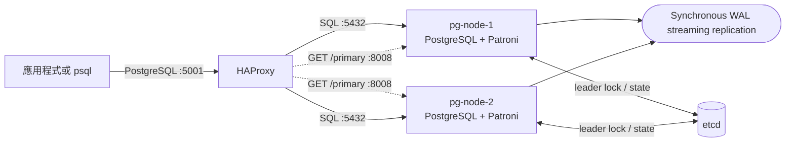
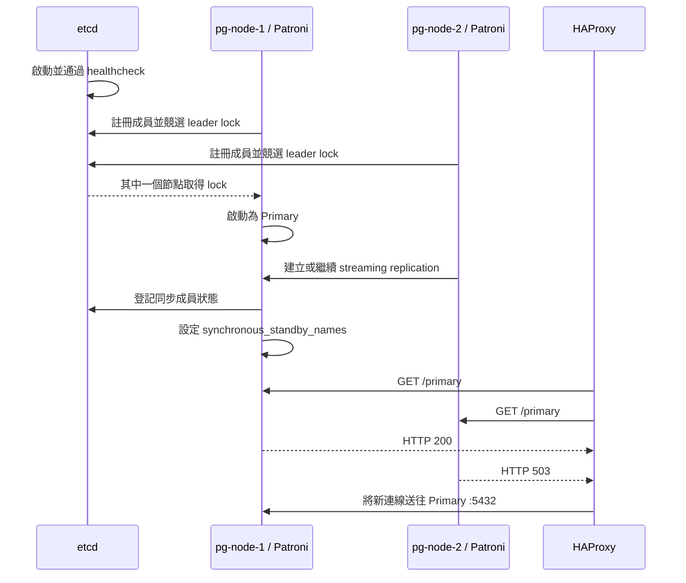
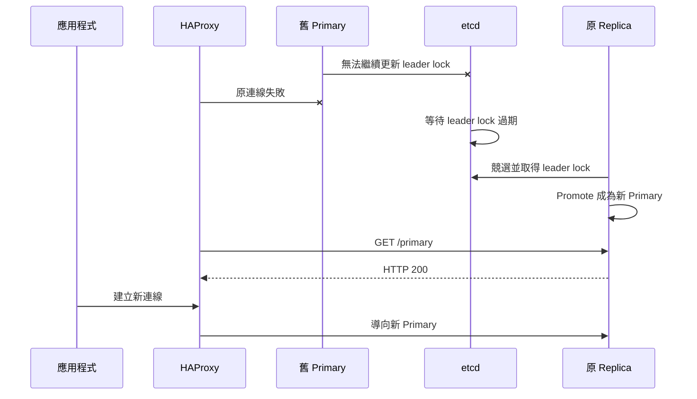

# PostgreSQL HA 架構教學

本文件介紹目前實驗環境中 PostgreSQL、Patroni、etcd 與 HAProxy 的用途，以及啟動、複寫、選主和故障切換的完整流程。

實際操作指令請參閱 [PostgreSQL HA 操作手冊](../operations/HA_DOC.md)。

## 一、什麼是 High Availability

High Availability，簡稱 HA，目標是當部分元件故障時，服務能在可接受時間內恢復，降低停機時間。

對 PostgreSQL 而言，HA 通常需要處理三件事：

1. 將 Primary 的資料持續複寫到一個或多個 Replica。
2. Primary 故障時，安全地選出一個 Replica 並將它提升為新 Primary。
3. 讓應用程式不必知道哪個節點是 Primary，仍能連到正確的可寫節點。

這套環境分別使用：

- PostgreSQL synchronous streaming replication 處理資料複寫；Replica 健康時，Primary 會等待一個同步副本確認 WAL 已持久化。
- Patroni 處理節點狀態與自動選主。
- etcd 儲存叢集共識、成員狀態及 leader lock。
- HAProxy 提供固定的應用程式連線入口。

HA 不等於備份，也不等於災難復原。HA 解決的是服務連續性；備份與 PITR 解決的是誤刪、資料毀損及回復到歷史時間點。相關原理請參閱 [PostgreSQL Backup 教學](./BACKUP_DOC.md)。

## 二、目前架構



主機對外提供的連接埠：

| Port | 用途 |
| --- | --- |
| `5001` | 應用程式透過 HAProxy 連到目前 Primary；容器內部仍監聽 `5000` |
| `5432` | 直接連 pg-node-1，主要用於實驗與診斷 |
| `5433` | 直接連 pg-node-2，主要用於實驗與診斷 |
| `7001` | HAProxy 狀態頁，只綁定 localhost；容器內部仍監聽 `7000` |
| `8008` | pg-node-1 Patroni REST API，只綁定 localhost |
| `8009` | pg-node-2 Patroni REST API，只綁定 localhost |

## 三、PostgreSQL Primary 與 Replica

### Primary

Primary 接受讀寫交易。資料修改會先寫入 WAL，再由 WAL sender 傳送給 Replica。目前使用 `synchronous_commit=on`，所以 Primary 會等一個同步 Replica 將 WAL flush 到持久儲存後，才向 client 回覆 commit 成功。

可用以下 SQL 判斷：

```sql
SELECT pg_is_in_recovery();
```

Primary 回傳：

```text
false
```

### Replica

Replica 持續接收並重播 Primary 的 WAL，因此資料會逐步追上 Primary。Replica 處於 recovery，只允許唯讀查詢。

Replica 回傳：

```text
true
```

Patroni 顯示 `streaming` 時，通常代表該 Replica 的 WAL receiver 正常連接 Primary 並持續接收資料。在目前設定下，健康的 Replica 會被 Patroni 選為 `Sync Standby`，PostgreSQL 的 `pg_stat_replication.sync_state` 應顯示 `sync`。

### 為什麼服務名稱不使用固定的 primary/standby

角色會在 failover 或 switchover 後互換。`pg-node-1` 可能今天是 Primary，下一次切換後成為 Replica。使用中性的 node 名稱可避免把實體節點與動態角色混為一談。

## 四、WAL 與 Synchronous Streaming Replication

WAL 是 Write-Ahead Log。PostgreSQL 在修改資料頁之前，會先把變更記錄寫入 WAL，以支援 crash recovery 和 replication。

Streaming replication 的基本流程：

1. 應用程式在 Primary 提交交易。
2. Primary 將交易寫入本機 WAL。
3. Primary 的 WAL sender 將 WAL 串流給 Replica。
4. Replica 的 WAL receiver 接收 WAL。
5. Replica 重播 WAL，產生與 Primary 相同的資料變更。

目前設定是可降級的同步複寫：

```yaml
synchronous_mode: true
synchronous_mode_strict: false
synchronous_node_count: 1
postgresql:
  parameters:
    synchronous_commit: 'on'
```

其含義是：

- Patroni 負責設定及更新 `synchronous_standby_names`。
- Replica 健康時，每次成功 commit 必須取得一個同步 Replica 的 WAL flush 確認。
- 當 Primary 故障時，Patroni 只會自動 promote 確定包含成功交易的同步節點。
- 當沒有同步 Replica 時，Patroni 可暫時清除同步要求，讓剩餘 Primary 繼續寫入。

這個選擇在兩個節點都正常時提供同步耐久性，並在只剩一個節點時保留寫入可用性。代價是降級期間的新交易只有一份；若唯一存活節點在 Replica 追上前再次故障，可能遺失這段期間的交易。

兩節點架構無法同時保證「任一節點故障後持續寫入」與「每筆成功交易永遠至少有兩份」。若兩項都需要，至少要有三個分散於不同故障域的 PostgreSQL 節點，並讓新 Primary 在第一次故障後仍有同步 Replica。

`maximum_lag_on_failover: 1048576` 仍用於排除落後太多的 failover candidate，但同步安全性主要由 Patroni DCS 中的同步狀態與 PostgreSQL 的 `synchronous_standby_names` 保證。

同步模式也不是無條件的絕對零資料遺失。如果 session 將 `synchronous_commit` 改為 `off` 或 `local`，該交易會繞過遠端同步等待；另外，client 在等待確認時取消 backend 也存在特殊邊界情況。因此監控與應用程式設定仍然重要。

這些值位於獨立的 `patroni/patroni.yml` 內。Compose 使用 `configs.file` 將它掛載成 `/etc/patroni/patroni.yml`，因此編輯器可以把內容當成真正 YAML 處理，而不是把整段 Patroni 設定視為 Compose 多行字串。

其中 `bootstrap.dcs` 只負責新叢集的第一次 bootstrap。已經存在的叢集必須使用 `patronictl edit-config` 更新 etcd 中的動態設定；完整命令請見操作手冊的「將同步設定套用至既有叢集」。

外部 config 檔不會進行 Compose 環境變數插值。目前 `pg_hba` 固定使用 replication username `replicator`，密碼仍透過 `PATRONI_REPLICATION_PASSWORD` 環境變數提供。若日後修改 replication username，必須同時更新 `.env` 和 `patroni/patroni.yml`。

## 五、Patroni 的用途

Patroni 是 PostgreSQL HA 管理器。它不是資料庫，也不負責傳送實際資料；資料複寫仍由 PostgreSQL 完成。

Patroni 的主要工作包括：

- 初始化 PostgreSQL 叢集。
- 建立及管理 streaming replication。
- 選擇及管理同步 Replica，並更新 `synchronous_standby_names`。
- 將目前 Primary 身分寫入 DCS。
- 定期更新 leader lock。
- 偵測 Primary 是否仍健康。
- 在符合條件時將 Replica promote 為 Primary。
- 處理計畫性 switchover。
- 協助舊 Primary 使用 `pg_rewind` 回到 Replica 狀態。
- 提供 REST API 給監控工具與 HAProxy 查詢角色。

### Patroni REST API

常用 endpoint：

| Endpoint | HTTP 200 的條件 |
| --- | --- |
| `/health` | 本節點 PostgreSQL 正常運作 |
| `/primary` | 本節點是持有 leader lock 的 Primary |
| `/replica` | 本節點是健康的 Replica |
| `/patroni` | 回傳完整節點狀態資訊 |
| `/cluster` | 回傳叢集拓撲資訊 |

Docker healthcheck 使用 `/health`，因為 Primary 和 Replica 只要 PostgreSQL 正常都應視為健康。

HAProxy 使用 `/primary`，因為寫入流量只能送到目前 Primary。

### 重要時間參數

目前設定：

```yaml
ttl: 30
loop_wait: 10
retry_timeout: 10
synchronous_mode: true
synchronous_mode_strict: false
synchronous_node_count: 1
```

- `loop_wait`：Patroni HA loop 的一般執行間隔。
- `retry_timeout`：DCS 或 PostgreSQL 操作失敗時的重試時間範圍。
- `ttl`：leader lock 的有效期限。
- `synchronous_mode`：由 Patroni 管理同步複寫及可安全自動 promote 的節點。
- `synchronous_mode_strict`：目前為 `false`；沒有同步 Replica 時允許 Patroni 暫時解除同步要求以維持寫入。
- `synchronous_node_count`：要求一個同步 Replica。

當 Primary 容器停止後，其他節點不會立刻 promote。Patroni 必須先確認 leader lock 已失效，才可安全競選，因此實驗中看到數十秒的切換時間是正常現象。

## 六、etcd 的用途

etcd 是 Distributed Configuration Store，簡稱 DCS。Patroni 將它當成叢集的共識來源。

etcd 中保存的重點不是完整 PostgreSQL 資料，而是：

- 叢集目前有哪些 Patroni 成員。
- 哪個成員持有 leader lock。
- 動態 Patroni 設定。
- Failover、switchover 及叢集狀態相關資訊。

### Leader lock 為什麼重要

每個 Patroni 節點都能看到 etcd 中的 leader lock。只有成功持有並持續更新 lock 的節點，才能維持 Primary 身分。

如果舊 Primary 與 etcd 失去聯絡，它不能假設自己仍是唯一 Primary。Patroni 會採取保守策略，避免另一側已選出新 Primary 時舊 Primary 繼續寫入，造成 split-brain。

### etcd quorum

正式 HA 通常使用奇數個 etcd 成員，例如三個：

- 1 個 etcd：需要 1 票，容忍 0 個節點故障。
- 3 個 etcd：需要 2 票，容忍 1 個節點故障。
- 5 個 etcd：需要 3 票，容忍 2 個節點故障。

目前只有一個 etcd，足以學習 Patroni 選主與 PostgreSQL failover，但 etcd 本身不是 HA。它停止時，沒有其他成員可以繼續提供 DCS quorum。

## 七、HAProxy 的用途

Patroni 可以決定誰是 Primary，但應用程式仍需要一個固定連線位置。HAProxy 提供這個固定入口：

```text
localhost:5001
```

HAProxy backend 同時列出兩個 PostgreSQL 節點，但健康檢查不是單純測試 `5432` 是否有回應，而是查詢每個節點的 Patroni `/primary`。

```haproxy
backend patroni_primary
    option httpchk GET /primary
    http-check expect status 200

    server pg-node-1 pg-node-1:5432 check port 8008
    server pg-node-2 pg-node-2:5432 check port 8008
```

這段設定的意思是：

- 實際 SQL 流量送往 `5432`。
- 健康檢查改查 Patroni `8008`。
- 只有 `/primary` 回傳 `200` 的節點可接收流量。
- Replica 在這個 backend 會顯示 `DOWN`，但它可能仍是健康的 streaming Replica。

### HAProxy 能做什麼

- 提供固定的 Primary 連線入口。
- 偵測 Patroni 角色變更。
- Failover 後把新連線導向新 Primary。
- 在狀態頁顯示 backend 狀態。

### HAProxy 不能做什麼

- 不會複寫 PostgreSQL 資料。
- 不會決定誰能成為 Primary。
- 無法保存已中斷的資料庫 session 或 transaction。
- 單一 HAProxy 容器本身仍是單點。

實際應用通常需要 connection pool 或應用程式重試機制，以處理 failover 期間的短暫斷線。

### HAProxy 故障時的多主機備援

部分 PostgreSQL 用戶端驅動支援多主機連線。以 DBeaver 使用的 PostgreSQL JDBC Driver 為例，可以直接列出兩個 PostgreSQL 節點：

```text
jdbc:postgresql://127.0.0.1:5432,127.0.0.1:5433/postgres?targetServerType=primary&connectTimeout=3
```

Driver 會逐一嘗試節點，並利用 `targetServerType=primary` 只接受目前可寫的 Primary。因此單一 HAProxy 故障時，使用者仍可透過另一個連線設定直接存取資料庫。

這是 client/driver 的備援能力，不代表資料庫 session 可以無縫移轉。Primary 或 HAProxy 故障後，舊 TCP session 與未完成 transaction 仍可能失敗，應用程式必須重新連線，並且只重試具備冪等性或已確認最終狀態的操作。直接暴露 PostgreSQL 節點也會增加網路與存取控制責任；正式環境通常改用兩個以上的 HAProxy、VIP 或外部 Load Balancer，避免把資料節點當成一般公開入口。

## 八、啟動時發生什麼事



首次啟動時不保證 node 1 一定先成為 Primary。角色由 Patroni 的 leader election 決定。

## 九、Primary 故障時發生什麼事



可觀察到：

1. 舊連線中斷。
2. 在 leader lock 失效及新節點 promote 期間，短時間沒有可寫節點。
3. Patroni 只會自動選擇已登記且具有安全 WAL 位置的同步 Replica。
4. HAProxy 偵測新 Primary 後，新連線恢復。
5. 若沒有其他 Replica，Patroni 暫時解除同步要求；此後的新交易只有一份，直到舊節點重新加入並追上。

這段從故障到恢復所需時間可視為本次實驗的 RTO。

## 十、舊 Primary 為什麼會自動變成 Replica

舊 Primary 恢復時，叢集已經有新的 timeline 和新的 Primary。它不能直接以舊 Primary 身分繼續接受寫入，否則會造成兩套不同資料歷史。

Patroni 會確認目前 leader lock，然後嘗試：

1. 停止舊 Primary 的寫入能力。
2. 使用 `pg_rewind` 將分歧的資料頁與新 Primary 對齊。
3. 將它設定成追隨新 Primary。
4. 以 Replica 身分啟動並回到 `streaming`。
5. Patroni 將健康且追上的 Replica 選為新的 Sync Standby。

目前已啟用：

```yaml
use_pg_rewind: true
wal_log_hints: 'on'
```

初始化時也啟用了 data checksums。這些設定有助於 `pg_rewind` 處理 timeline 分歧。

如果 rewind 無法修復，可由 Primary 重新 clone 該 Replica，操作上稱為 reinitialize。

## 十一、Failover、Switchover 與 Reinitialize

### Failover

Primary 非預期故障後，由 Patroni 自動或由管理者手動選出新 Primary。

特性：

- 原 Primary 可能已無法聯絡。
- 自動 failover 只會選擇 Patroni 確認安全的同步 Replica。
- 已成功回覆且沒有繞過 `synchronous_commit` 的交易，應已在同步 Replica 持久化。
- 目標是盡快恢復服務。

### Switchover

在原 Primary 和 Replica 都健康時，計畫性地交換角色。

用途：

- 維護主機。
- 演練角色切換。
- 驗證應用程式與 HAProxy 的重連能力。

通常比非預期 failover 更可控。

### Reinitialize

刪除指定 Replica 的本機資料，重新從 Primary 建立完整副本。

它不是一般重啟指令，而是 Replica 修復的最後手段。使用前必須確認目標不是 Primary，而且該節點的本機資料允許被覆蓋。

## 十二、常見狀態如何解讀

| 觀察結果 | 意義 |
| --- | --- |
| `Leader / running` | 目前 Primary，正常接受讀寫 |
| `Sync Standby / streaming` | 正常同步接收 WAL，並負責確認同步 commit |
| `Replica / streaming` | 正常接收並重播 WAL，但需再確認 `sync_state` 是否為 `sync` |
| `Replica / starting` | Replica 正在啟動或恢復 |
| `/primary` 回傳 `200` | 該節點是持有 leader lock 的 Primary |
| `/primary` 回傳 `503` | 該節點不是 Primary，不一定代表故障 |
| `/replica` 回傳 `200` | 該節點是健康 Replica |
| `pg_is_in_recovery() = false` | PostgreSQL 處於 Primary 模式 |
| `pg_is_in_recovery() = true` | PostgreSQL 處於 recovery/Replica 模式 |
| `pg_stat_replication.sync_state = sync` | 該 WAL sender 對應目前同步 Replica |
| 兩個節點都是 `true` | 可能暫時沒有 Primary，需查 Patroni 與 etcd |
| 兩個節點都是 `false` | 高風險 split-brain，應立即停止寫入並調查 |

## 十三、不同故障的預期結果

| 故障 | 預期結果 | 目前限制 |
| --- | --- | --- |
| Sync Standby 容器停止 | 短暫等待後降級為單節點讀寫 | 降級期間的新交易只有一份 |
| Primary 容器停止 | Sync Standby 經選舉後 promote 並恢復寫入 | 有數十秒切換時間，舊連線會中斷；修復前資料只有一份 |
| 舊 Primary 恢復 | 自動成為 Replica，追上後可成為 Sync Standby | rewind 失敗時可能需要 reinit |
| HAProxy 停止 | PostgreSQL 仍運作 | 統一入口 `5001` 中斷 |
| etcd 停止 | Patroni 無法更新 DCS | 單節點 etcd 無 quorum 備援 |
| Docker 主機停止 | 全部元件中斷 | 所有容器都在同一故障域 |
| 誤刪資料 | 刪除會複寫到 Replica | 需要獨立備份/PITR 才能復原 |

## 十四、RTO 與 RPO

### RTO

Recovery Time Objective 是服務故障後允許多久恢復。

本環境的 RTO 受到以下因素影響：

- Patroni `ttl` 與 HA loop。
- Replica promote 所需時間。
- HAProxy `inter`、`fall` 與 `rise` 健康檢查參數。
- 應用程式建立新連線或重試的速度。

### RPO

Recovery Point Objective 是可接受遺失多少最新資料。

兩個節點健康時，成功回覆的 commit 已同時持久化在 Primary 與同步 Replica，因此相較全程非同步複寫具有更強的 RPO 保障。

但這不代表任何情況下都是零資料遺失。當 Replica 不可用時，`synchronous_mode_strict=false` 允許 Primary 單機提交；若唯一節點在 Replica 追上前故障，這些交易可能遺失。此外，client 可逐筆修改 `synchronous_commit`，等待同步確認時取消 backend 也有特殊邊界情況，兩份資料位於同一故障域時也可能同時遺失。

同步模式的主要取捨是延遲、耐久性與可用性。正常狀態下，每個 commit 多一次 Replica WAL flush 等待；降級狀態下，本環境選擇繼續寫入並暫時承擔只有單份資料的風險。

## 十五、這套實驗已經證明什麼

完成 Primary stop、Sync Standby promotion、HAProxy 切換、舊 Primary 重新加入，以及 Sync Standby 中斷時降級寫入的測試後，可以證明：

- PostgreSQL streaming replication 正常。
- Replica 健康時，PostgreSQL commit 會等待同步 Replica 的 WAL flush 確認。
- Patroni 能透過 etcd 取得 leader lock 並執行選主。
- Sync Standby 可以安全地自動 promote。
- HAProxy 可以辨識新的 Primary。
- 舊 Primary 可以回到 Replica，重新 streaming 並成為 Sync Standby。

但這仍不是跨主機的正式 HA，因為所有元件都在同一台 Docker 主機。

## 十六、走向正式環境時的下一步

1. 將 PostgreSQL 節點分散到不同主機或故障域。
2. 將 etcd 擴充為三個分散部署的成員。
3. 為 HAProxy 建立至少兩個實例，搭配 Keepalived、VIP、DNS 或外部 load balancer。
4. 建立獨立備份、WAL archive、PITR 與還原演練。
5. 監控 replication lag、WAL、磁碟、leader change 與 HAProxy backend。
6. 加入應用程式 connection retry 與 connection pool 策略。
7. 規劃 TLS、帳號最小權限、secret management 和網路隔離。
8. 根據實測 commit latency、RPO/RTO 與寫入可用性，評估兩節點可降級模式或三節點 strict 模式何者符合正式需求。

## 延伸閱讀

- [PostgreSQL 18 High Availability、Load Balancing and Replication](https://www.postgresql.org/docs/18/high-availability.html)
- [PostgreSQL Streaming Replication](https://www.postgresql.org/docs/18/warm-standby.html)
- [Patroni Documentation](https://patroni.readthedocs.io/en/latest/)
- [Patroni REST API](https://patroni.readthedocs.io/en/latest/rest_api.html)
- [Patroni Replication Modes](https://patroni.readthedocs.io/en/latest/replication_modes.html)
- [etcd Documentation](https://etcd.io/docs/)
- [HAProxy Health Checks](https://www.haproxy.com/documentation/haproxy-configuration-tutorials/reliability/health-checks/)
